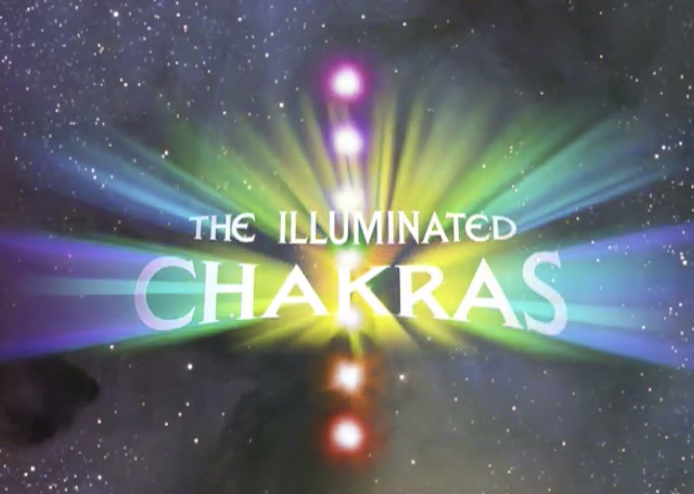

Before I was a professional engineer, I explored working with 3D art and animation.

I created the visuals for _The Illuminated Chakras_, a 28-minute journey through the chakra system, written and narrated by Anodea Judith, with music by Robin Silver. The DVD was released on April 27, 2004, in all the glory of 4:3 480p.

The project took about a year and a half, with the work split roughly between 25% 3D Studio Max, 5% Photoshop, and 70% After Effects.

[Watch the official trailer on YouTube](https://www.youtube.com/watch?v=p8RIOfKj5gE).

[Watch the full film on Vimeo](https://vimeo.com/70197929) (pardon the aspect ratio).
