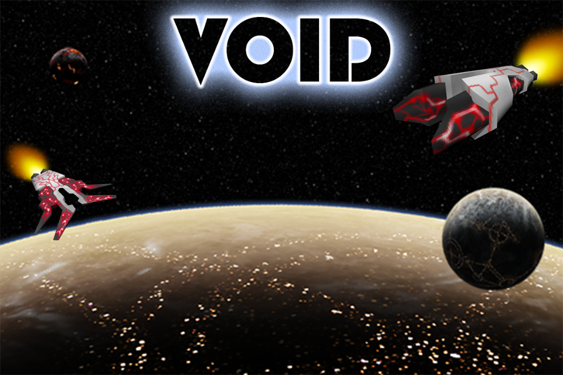

_VOID_ is an iOS game I created for the iPhone in 2009. Pilot a ship with inertial physics through combat missions, collect weapons and equipment, and upgrade your loadout between trips.

[Play VOID in your phone's browser](https://alexjwayne.github.io/void-revived/) (experimental).

I designed and built most of the game, including nearly all of the technical work, UI design, and some art. I recruited help with music, art, and game balancing from an online video game enthusiast community I was a part of.

The original game was written in Objective-C with OpenGL ES rendering. Sadly, I didn't keep it compatible with newer versions of iOS over the years. So, in the fall of 2026, I used GPT-6 Astra to port it to WebGL and Preact, allowing it to run in a mobile browser. I also experimented with vibe-upgrading the shipyard UI to make it prettier, more useful, and more consistent with modern design standards.

The AI port exceeded my expectations, although the resulting TypeScript isn't up to my current code quality standards. But for an experiment intended to revive an old game rather than build a new product, I'm okay with that tradeoff. The fact that this works feels like a small miracle.

Lastly, I'm still awaiting my Hugo award for this absolute banger:

