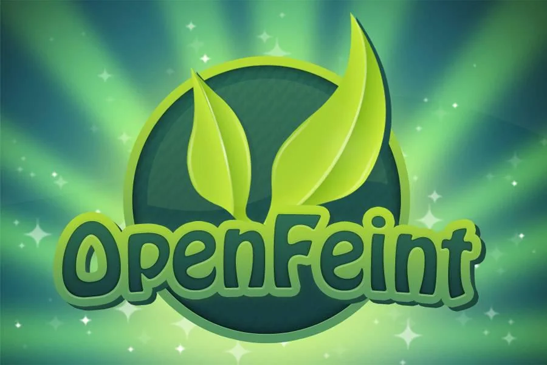

At OpenFeint, we built a social gaming platform for mobile games, serving hundreds of millions of users. I worked across the stack, from the Ruby on Rails backend to JavaScript UIs, and native iOS features in Objective-C. I was principal engineer on a web-based UI framework that emulated a native look and feel and could download updated code, letting us ship UI and feature updates without an App Store submission. I also led development of Game Channel, an iOS app that featured a free game each day.

