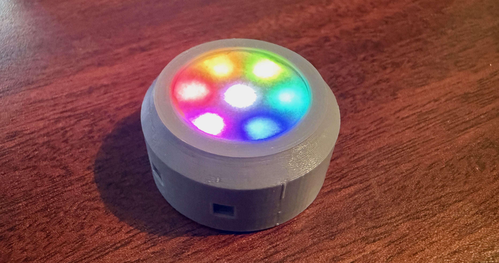
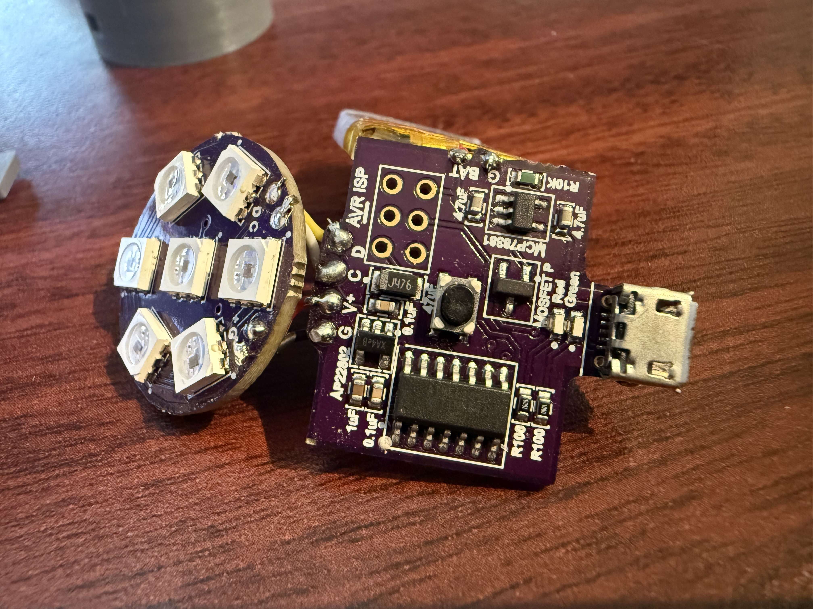
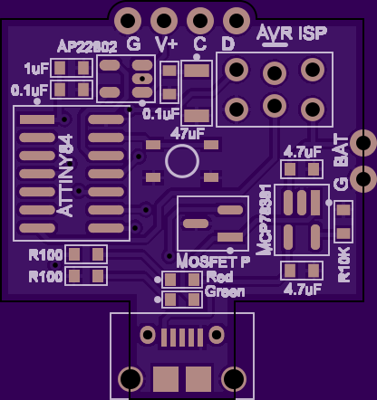

This project was a custom electronics journey. It's a small circular pendant with seven RGB LEDs. The hardware and software were completely custom, right down to the PCBs, firmware, and enclosure.

### Features

- 8 animation modes
  - Rainbow - Hues swirl
  - Red - Slow rotating fade, like hot magma
  - Orange - Dual pulses from the center and outer ring dance together
  - Yellow - Sparking slightly chaotic flames
  - Green - Soft swirling heartbeat
  - Blue - Vibrating as if holding a high note
  - Indigo - Two orbs orbit a pulsing center
  - Violet - Alternating sets of three, pulse between each other
  - Showcase - Rotates through all animation modes
- One-button interface
  - Hold to turn on/off
  - Tap to change animation modes
  - Hold longer while the pendant is on to enter showcase mode
- Built-in battery, USB rechargeable
- Charging status lights: amber while charging, green when fully charged
- Ultra-low power consumption when off, despite no mechanical off switch

### Build

- 1 custom front PCB for the LEDs
- 150 mAh LiPo battery
- 1 custom back PCB for the microcontroller and battery charging
- 7 APA102 addressable RGB LEDs
- 1 ATTiny84 microcontroller
- 2 battery status LEDs
- 1 momentary switch
- 1 battery charging controller
- Assorted resistors and capacitors
- Surface-mount components, soldered using a converted toaster oven
- Custom two-piece, 3D-printed enclosure

