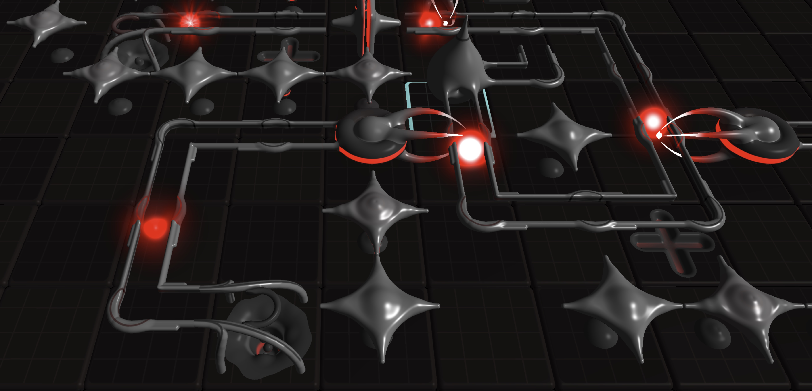

This is a game I've been thinking about for a long time. It's a factory game driven by a rhythmic beat and built around the concept of amplifying energy through purposeful arrangements of liquid metal alien machines. Timing is key, as the heartbeat of the world itself means that plasma must be routed into your machines with a precise cadence in order to be effective. Produce, amplify, and collect plasma in order to unlock new technologies that allow you to produce, amplify, and collect plasma in more effective ways.

An aspiration I have is to use no traditional game assets. For example, 3D objects are raymarched SDFs, surfaces use procedural materials, and sound is generated on the fly from synthesizer envelopes. The game assets are pure code.

Work on this game resulted in the open-source renderer [Luxscura](./2026-10-15-luxscura). During development, I discovered I had a useful abstraction for raymarching 3D SDFs built on top of [TypeGPU](https://docs.swmansion.com/TypeGPU/), and I thought others might find it helpful.

It's also far from complete. Perhaps it will never be complete. Such is the nature of side projects.

Stay tuned for updates. Maybe.
