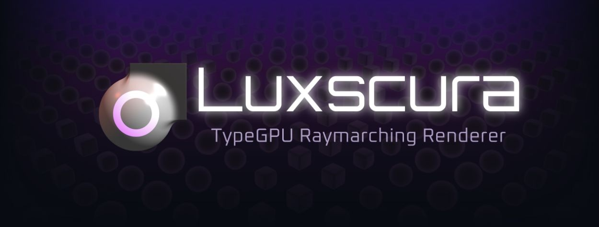

[Luxscura](https://alexjwayne.github.io/luxscura/) is an open-source raymarching renderer built with [TypeGPU](https://docs.swmansion.com/TypeGPU/). Define shapes as signed distance functions, choose a camera and appearance, and render them on the GPU with WebGPU, all in TypeScript.

It includes matte, glossy, and experimental physically based shading, with interactive examples to explore how shapes, lighting, and materials work together.

